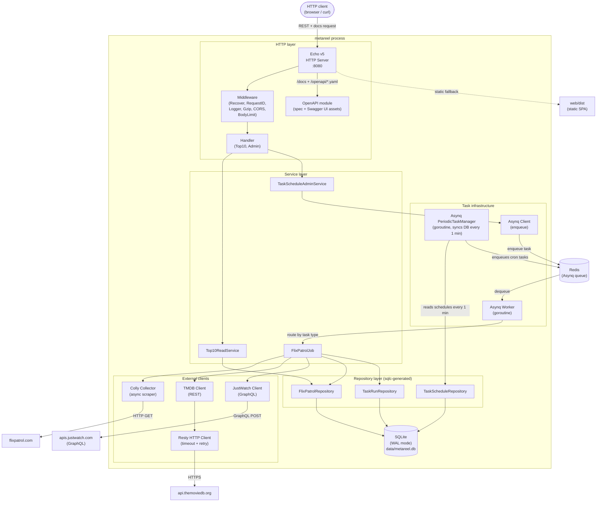
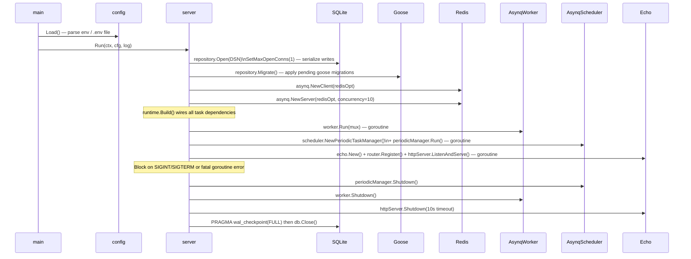
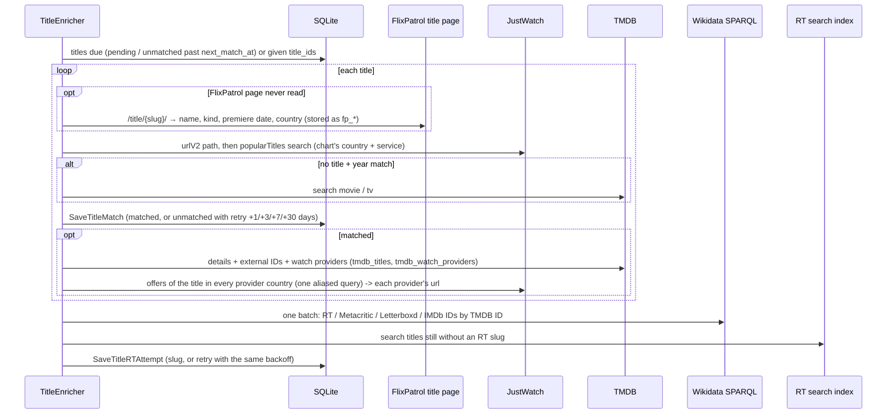
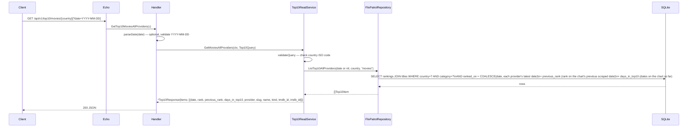
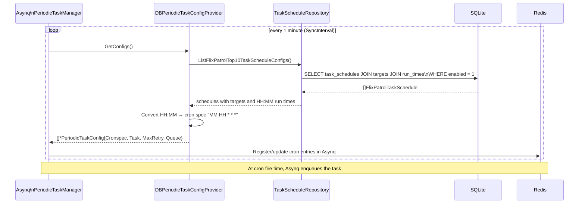
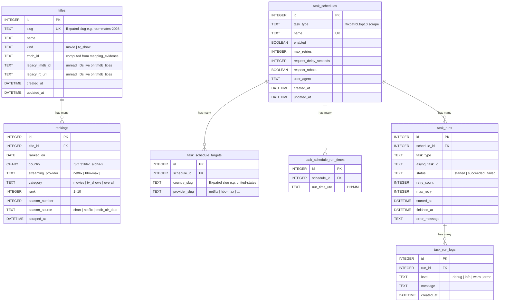

# metareel — Architecture

## Overview

metareel is a Go backend service that scrapes daily Top 10 streaming rankings from [FlixPatrol](https://flixpatrol.com), matches each title to TMDB / IMDb / Rotten Tomatoes (JustWatch GraphQL, TMDB, Wikidata SPARQL, RT's search index), adds TMDB metadata and watch providers, Netflix's official weekly Top 10 and IMDb's ratings dataset, persists everything in SQLite, and exposes a JSON REST API for charts, title performance, ratings, availability and analytics.

The HTTP contract is defined by embedded OpenAPI specs (`/openapi/public.yaml` and `/openapi/admin.yaml`) and served through Swagger UI (`/docs` and `/docs/admin`).

The service runs three concurrent subsystems in a single process:

| Subsystem | Role |
|---|---|
| **Echo HTTP server** | Serves the read API and admin endpoints |
| **Asynq worker** | Processes background scrape jobs pulled from Redis |
| **Asynq periodic task manager** | Reads cron schedules from the DB and enqueues jobs automatically |

---

## Component Architecture



---

## Startup & Initialization Flow



---

## Jobs

Every background job is an asynq task type run from a DB schedule
(`task_schedules.task_type`) or on demand (`POST /api/v1/admin/jobs/:type/run`,
`/backfill`, a schedule's run-now). `tasks.ForSchedule` builds the task and its
options for both paths; every task is enqueued with `asynq.Unique`, so the same
run can't be queued twice (409 from the API). asynq archives a task whose
last attempt failed and keeps its lock until it expires (the job's timeout),
so manual runs (`/jobs/:type/run`, a schedule's run-now, `/backfill`) first
delete an identical archived task (`enqueueUnique`, through the inspector)
and enqueue again; only a queued, running or retrying copy is a conflict. `handlers.Runner` records each
attempt in `task_runs` (status `started | succeeded | partial | failed`,
target counts, JSON `summary`) and `task_run_logs`, and posts an alert when the
last attempt fails (`ALERT_WEBHOOK_URL`). Ad-hoc runs have no `schedule_id`.

| Task type | Service | Notes |
|---|---|---|
| `flixpatrol.top10.scrape` | `FlixPatrolJob` | Charts only; tags the new TV rankings with seasons, enqueues `titles.enrich` for new titles and hourly re-checks for unpublished charts |
| `titles.enrich` | `TitleEnricher` (+ `TitleMatcher`) | Mapping sync (linked Netflix titles' mappings first), matching with backoff, RT via Wikidata then search (per TMDB title, backoff in `tmdb_titles.next_rt_at`), mapping sync; then seasons |
| `titles.metadata` | `TitleMetadataService` | TMDB details (incl. TV season lists) + watch providers with each offer's URL from JustWatch (`title_offers.go`), Wikidata IDs, films' Wikidata distributors (P750, `tmdb_titles.distributors`, monthly); then seasons |
| `ratings.prewarm` | `RatingsService.Prewarm` | Charting titles' expired ratings |
| `netflix.top10.import` | `NetflixImporter.Run` | Netflix TSVs, matching of up to 400 due Netflix titles (mapping sync, Netflix IDs, Wikidata, JustWatch), seasons |
| `netflix.titles.match` | `NetflixImporter.RunMatch` | Netflix title matching backlog (or `title_ids`), Netflix IDs of up to 200 more titles, then seasons |
| `imdb.ratings.import` | `IMDbImporter` | IMDb `title.ratings.tsv.gz`; known IDs also go to `imdb_rating_history` when changed |
| `tmdb.credits.refresh` | `CreditsRefresher` | `tmdb_people` + `tmdb_credits` of every TMDB title: `/movie/{id}/credits`, or `/tv/{id}?append_to_response=aggregate_credits` (with `created_by` as Creator); keeps the top 25 cast and the jobs in `creditJobs` (TV: 10 per job by episodes); never-fetched first, again after 60 days (`tmdb_titles.credits_fetched_at`), 1,000 a run, 250 ms apart; each title replaced in one transaction |
| `tmdb.episodes.refresh` | `EpisodesRefresher` | `tmdb_episodes` of TV shows with a stored TMDB season list: seasons aired in the last 3 years, undated and the latest (`append_to_response=season/N`, 20 per request, 250 ms apart); due daily when an episode airs within -14..+60 days or a season starts within 30 days, weekly for returning statuses, else monthly (`tmdb_titles.episodes_fetched_at`); each fetched season replaced in one transaction |
| `wikipedia.pageviews.import` | `PageviewsImporter` | English Wikipedia daily user views (Wikimedia REST, `client.Wikimedia`) of titles with `tmdb_titles.enwiki_title`, since the last stored day (90 days first); 350 ms apart (200 requests/minute limit), `Retry-After` honoured on 429 |
| `netflix.engagement.import` | `NetflixEngagementImporter` | "What We Watched" `.xlsx` reports from `app_settings` `netflix.engagement.urls` (defaults in code; a run's `url` adds one), parsed by `internal/xlsx`; each period replaced in one transaction, rows linked by name to Netflix Top 10 titles / season titles |
| `tmdb.popularity.import` | `TMDBPopularityImporter` | TMDB daily ID exports (`movie_ids_MM_DD_YYYY.json.gz`, `tv_series_ids_…`): popularity of known TMDB titles into `tmdb_popularity_history`; yesterday's file until today's is out |
| `mapping.refresh` | `TitleMappingService.Refresh` | Queued by the mapping writer after mapping changes (payload: `tmdb_refs`, `netflix_title_ids`; not unique): TMDB details (skipped if fetched within 24 h and an IMDb ID is known) + Wikidata IDs (titles never looked up; the metadata job rechecks the rest) of the TMDB titles now mapped to, seasons of the Netflix titles that changed or sit on those TMDB titles, ranking season tags. Run by hand (empty payload) it first runs a mapping sync |
| `maintenance` | `MaintenanceService` | Retention, stale-chart alerts, deletes `tmdb_people` without any `tmdb_credits` left and expired / idle `sessions`, `PRAGMA optimize` |

FlixPatrol fetches from every job go through one `flixpatrol.SerialFetcher`:
one page at a time, `SCRAPER_MIN_INTERVAL` apart.

"Then seasons" is `SeasonMapper.Refresh` (`service/seasons.go`): every Netflix
season title not fixed by hand is (re)mapped to a TMDB season number by
`ResolveNetflixSeason` (explicit "Season N" / "S N" / "Limited Series" →
TMDB season name → "Part / Volume / Chapter N" → TMDB season aired just
before it first charted, or before a date in the title → single-season show),
then FlixPatrol TV rankings whose chart did not name a season get one
(`rankings.season_source`): on Netflix charts the best-ranked mapped season of
the show in Netflix's Top 10 that week (country list, else global), otherwise
the latest TMDB season aired by that date. Admin fixes of a Netflix season or
title remap just that title (`RefreshTitle`).

Netflix titles are reviewed under `/api/v1/admin/netflix/titles` like
FlixPatrol titles: manual IDs lock a title (`match_status = manual`) and
rematch queues `netflix.titles.match` for it.

### TMDB mapping (`service/title_mapping*.go`, `service/netflix_ids.go`)

TMDB titles (`tmdb_titles`) are the hub of one mapping: `titles.kind` +
`tmdb_id` and `netflix_titles.tmdb_kind` + `tmdb_id` point at them
(`netflix_titles.kind` stays Netflix's list, which can differ). Each TMDB
title is the only home of external IDs: IMDb, Wikidata, RT, Metacritic,
Letterboxd, `netflix_id` (Wikidata P1874 / Tudum) and `justwatch_id`; titles
and Netflix titles read them through their mapping (the old per-title
columns are kept as `legacy_*` for one release, unread). Each ID has a
`*_source` column (`manual` > `tmdb` > `wikidata` > `match` > `netflix`), and every write
goes through one query (`saveTmdbIDs` → `SaveTmdbIDs`) that only replaces an
ID from the same or a weaker source: TMDB details, Wikidata, matching
(IDs a JustWatch match came with) and ratings (IDs found while fetching).
IMDb / Wikidata / RT IDs given by hand (FlixPatrol / Netflix title PATCH,
remap by IMDb or Wikidata ID) go to `TitleMappingService.SetManualIDs` as
`manual`; `""` clears one and hands it back to the next refresh. The RT
lookup (`titles.enrich`) works per TMDB title (`tmdb_titles.rt_attempts`,
`next_rt_at`), so manual titles get slugs too.
A Netflix title's own Netflix ID (Tudum) also becomes its TMDB title's while
that has none (source `netflix`, the weakest: any other source replaces it).
`MetadataRepository.SyncNetflixIDs` keeps these copies in step with the
Netflix titles' mappings (dropping a copy whose Netflix title moved away); it
runs in every `mapping.refresh` and after each Netflix ID pass. Netflix-ID
matching ignores copied IDs (they only repeat the title's own mapping);
`GET /titles/lookup?netflix=` finds them.
`GET /admin/data-quality` lists mapped titles whose deciding evidence came
with an IMDb ID other than their TMDB title's (`imdb_mismatches`, with the
evidence kind and source), and Netflix titles whose own Netflix ID differs
from their TMDB title's when that came from a stronger source than a copy
(`netflix_id_mismatches`; `other_title_has_id` marks a special or season of a
show whose own Netflix title has the ID; titles fixed by hand last).

**Evidence.** A title's mapping is computed, never copied
(`service/mapping_compute.go`). Writers store `mapping_evidence` — one row
per title and kind: `manual` (fixed by hand, possibly as unmapped),
`netflix_id` (a Netflix title's Netflix ID), `match` (automatic match, with
the IMDb ID it came with and, for Netflix, the FlixPatrol title it went
through). `computeMapping` takes the title's strongest evidence and that of
the titles directly linked to it (see Sharing): a fix by hand on the title
stands; otherwise the group's anchor wins (`match_source`
`flixpatrol_title` / `netflix_title` when it is another title's), else the
title's own evidence, else nothing (a title that had a mapping becomes
`pending`). Each write recomputes the titles it touches and their linked
titles in the same transaction, so withdrawing evidence (rematch, clear)
withdraws what was shared from it with no undo bookkeeping. Rematch without
clear deletes the `manual` evidence, so the title's own earlier match applies
again; a fix that is all the title has is kept as `match` evidence instead,
so the mapping stays until matching finds another.

**One writer.** Every change to `titles.tmdb_id` / `netflix_titles.tmdb_id`
goes through `MappingWriter` (`service/mapping_writer.go`) and its
repository methods (`repository/mapping_write_repo.go`): automatic matches,
Netflix-ID matches, admin fixes, rematch / clear, sharing over links,
withdrawing shared mappings and remaps. Each write records a
`mapping_events` row (action, TMDB title before / after, source, actor = job
type, `mapping.sync` or `admin`) in the same transaction
(`GET /admin/mapping-events`). Writes happen in a `MappingSession` per job or
request; the session collects the TMDB titles newly mapped to and the
Netflix titles that changed and, on `Flush`, queues one `mapping.refresh`
for them. Inline work stays database-only (evidence + sync); admin fixes also
fetch the target's TMDB details when none are stored, so the response shows
the title. Without a queue (tests), the refresh runs inline.

`TitleMappingService.Sync` (run by the matching jobs, admin fixes,
`mapping.refresh` and `POST /admin/mappings/sync`; database only):

1. **Links** (`title_links`): `ComputeTitleLinks` pairs a Netflix title with
   a FlixPatrol title of the same normalized name (chart or page name, with or
   without ": Season N") on Netflix's chart of the same list (Films ↔
   `movies`, TV ↔ `tv_shows`) in the same or an adjacent Netflix week.
2. **Sharing**: each title weighs only itself and the titles directly linked
   to it that are linked to nothing else (so a fix never spreads through an
   intermediary, and a Netflix title linked to a show and its same-name
   revival fills neither); the anchor of that set is a title fixed by hand, else a Netflix
   title mapped by its Netflix ID, else FlixPatrol's match, else Netflix's.
   A non-manual title takes the anchor's TMDB kind + ID (`match_source`
   `flixpatrol_title` / `netflix_title`). A set whose deciding tier disagrees
   is a conflict (counted in the sync report and listed under Mapping → TMDB mappings →
   Conflicts): each title keeps its own evidence. Sync recomputes every
   linked title (and titles that lost a link) from evidence; a title that
   loses a mapping it had taken is recorded as `unshare` and falls back to its
   own. Netflix titles that changed get their seasons remapped by the
   follow-up `mapping.refresh`.

Netflix title matching order (`NetflixImporter.matchTitles`): mapping sync →
Netflix IDs (`resolveNetflixIDs`: Tudum's Top 10 search by show title, an
item whose name — a season title for TV — list and a charted week agree;
season IDs → show ID through the public title page's redirect; Netflix ID →
TMDB via `tmdb_titles.netflix_id`, else Wikidata P1874) → a same-name
FlixPatrol title in the same list → Wikidata items with a Netflix ID by
English label (`pickWikidataNetflix`; a title with its own Netflix ID only
takes an item with that ID, so the 2010 film is not taken for the 2025
remake) → JustWatch's US Netflix catalogue (the
list's kind, then the other) → TMDB (`netflix_tmdb.go`: search the list's
kind, then the other; hits whose title or original title is the name, else
an alternative title of the top hits, released no later than the year it
first charted; the only one TMDB shows streaming on Netflix in any country,
or among several the only recent release: `tmdb_netflix`,
`tmdb_netflix_alt_title`) → a unique exact name in JustWatch US → mapping
sync. Before that, label matches (`wikidata_netflix`) that the title's own
Netflix ID contradicts (its TMDB title has another, non-copied Netflix ID)
are cleared through the mapping writer (`clear` event) and matched again
(`requeueContradicted`, `contradicted_label_matches` in the run summary).
IMDb / Wikidata IDs given by hand resolve to TMDB through TMDB's
`/find`, then Wikidata (`TitleMetadataService.ResolveExternalID`).

## Scrape Job Flow

```mermaid
sequenceDiagram
    participant Trigger as Scheduler / run-now / backfill
    participant Worker as FlixPatrolHandler
    participant Job as FlixPatrolJob
    participant FP as FlixPatrol (via FlareSolverr)
    participant DB as SQLite
    participant Q as asynq

    Trigger->>Worker: flixpatrol.top10.scrape {targets, backfill_days, recheck_hours | dates}
    Worker->>DB: task_runs (started)
    Job->>FP: fetcher health check (all targets fail fast if down)
    loop each target × date (gaps from the last backfill_days, then today; oldest first)
        Job->>DB: chart_snapshots for date? → skip if both categories stored
        Job->>FP: GET /top10/{provider}/{country}/{date}/
        alt same content as the previous stored date and re-check window open
            Note over Job: not_fresh: not stored
        else
            Job->>DB: EnsureTitle per entry (new titles: match_status pending)
            Job->>DB: SaveChart (one transaction: delete chart, insert ranks + season numbers, upsert chart_snapshots)
        end
        Note over Job: 3 consecutive fetch failures stop the remaining pages
    end
    Worker->>Q: titles.enrich {title_ids: new titles}
    Worker->>Q: re-check not_fresh targets in 1h (until recheck deadline)
    Worker->>DB: task_runs (succeeded | partial | failed, counts, per-target summary)
    Note over Worker: failed pages → error → asynq retry; stored charts are skipped
```

## Title Matching Flow (`titles.enrich`)



`manual` titles (fixed in the admin UI) are never changed by automation.
`POST /api/v1/admin/titles/:id/rematch` clears the backoff (and with
`clear: true`, the IDs) and queues the title.

## Webhooks (`service/webhooks.go`)

A loop in the server process (`WebhookService.Run`, every 30 s, stopped
before the database closes) follows two sources with cursors in
`app_settings`:

- `webhooks.cursor.charts`: `chart_snapshots.changed_at` (set when a chart is
  stored or its content changes). Each pass re-reads charts changed up to 2
  minutes before the cursor (a re-scraped chart keeps its row id and gets its
  new `changed_at` when its transaction commits, possibly behind a cursor a
  concurrent pass already moved); repeats are dropped by event id
  (`UNIQUE(webhook_id, event_id)`). The re-read pages by (`changed_at`, id)
  (`ListChartsChangedAfter`), skips charts the dispatcher already handled (an
  in-memory id -> `changed_at` set for the lookback; empty after a restart)
  and turns at most 500 charts into events per pass. The cursor is the newest
  handled `changed_at`, so thousands of charts sharing one timestamp (a bulk
  import) are worked through over a few passes instead of stalling the
  cursor. A chart the read API rejects (e.g. an unknown country) yields no
  events rather than failing the pass. Charts at or before
  `webhooks.cursor.charts_floor` (where following started: time and highest
  row id) are never sent, so a first start doesn't replay history. Each chart
  is read through `Top10ReadService` and yields `chart.updated` plus
  `title.entered` (no `previous_rank`) and `title.number_one` (rank 1, not 1
  before); title events are keyed by chart and title, so a re-scrape doesn't
  repeat them.
- `webhooks.cursor.offers`: `watch_provider_events.id` →
  `availability.added` / `availability.removed`.
- `title.breakout`: when a pass queued events for charts of the current chart
  date or the two before it, and a webhook subscribes to the type,
  `BreakoutService` computes breakouts (defaults) for each such date and the
  day before; titles that are breakouts on the date but weren't the day before
  are queued, keyed by title and date. A title that keeps rising is announced
  once; a backfill of older dates announces nothing.

Events are queued in `webhook_deliveries` for each enabled webhook
subscribed to the type, then POSTed (10 s timeout, no redirects, no proxy,
response read up to 300 bytes for the error) with an HMAC-SHA256 signature.
The dialer checks every resolved address (`webhookDialControl`, so DNS
rebinding is covered): no link-local, multicast, unspecified or broadcast
addresses, loopback only with `WEBHOOK_ALLOW_LOOPBACK`. A receiver that
can't be reached is skipped for the rest of the pass. Failures
back off 1 m, 5 m, 30 m, 2 h, 12 h, then fail; finished deliveries older
than 30 days are pruned hourly. Errors never include the URL (it may carry
tokens) or the secret, which is stored in `webhooks.secret` (it is needed to
sign) and only returned when created or rotated.

CORS headers are only sent for the public API (the `Skipper` in
`router.Register`); the admin group runs `handler.SameOriginWrites`, which
refuses non-GET requests a browser marks as cross-site (`Sec-Fetch-Site`
other than same-origin / none, or an `Origin` whose host is not the request's
`Host` / `X-Forwarded-Host`), so pages on other sites can't drive the
admin API (open, or signed in with a SameSite=Strict cookie); clients without
those headers (curl) pass.

## Title search (`service/search.go`)

`GET /search` matches the names of every mapped TMDB title (TMDB title and
original title, FlixPatrol chart / page names, Netflix Top 10 names) from an
in-memory index: names folded (lowercase, accents removed, `&` → and,
punctuation → spaces) and split into words. The index is rebuilt when
`SearchIndexStamp` (counts and latest updates of `tmdb_titles`, `titles`,
`netflix_titles`, the newest chart and Netflix week) changes, checked at most
every 30 s; the rebuild is not cancelled with the triggering request and a
failed rebuild keeps the old index. Queries are capped at 200 bytes and 8
words, and scoring stops when the request is cancelled. Scores: whole name 100, prefix 85, all query words starting words
in order 70 / any order 60, substring 40; ties go to the most recently
charted title.

## Mapping review queue (`service/mapping_review.go`)

`GET /admin/mappings/review` (Mapping → Review queue) scores every automatic
mapping (FlixPatrol and Netflix titles not fixed by hand) 0–100 by how
likely it is wrong and lists the riskiest first (default `min_risk=25`;
`subject`, `reason` filters). Signals add up: the match source's base risk
(`sourceRisk`: 0 for a FlixPatrol title page path or a Netflix ID, up to 35
for a unique-name fallback; ≥ 20 shows as `weak_source`), `not_on_provider`
(+35: TMDB lists no offer of the service it charted on, in any country and
form — only checked when it charted there within 60 days before the offers
were fetched, since titles leave services; `providerOffers` maps FlixPatrol
providers to TMDB provider IDs), `released_later` (+40: TMDB release year
after it first charted), `imdb_mismatch` (+30: the match came with another
IMDb ID), `year_mismatch` (+25: films whose FlixPatrol premiere year is more
than a year off), `no_offers` (+15), `name_differs` (+15: the chart name,
without season suffixes, neither is nor contains TMDB's title), `no_details`
(+5). Computed on request; nothing is stored.

Each queue row has two one-click fixes in the admin UI: **Looks right** saves
the current TMDB title by hand, and **Find fix** loads
`GET /admin/mappings/review/{subject}/{id}/suggestions`
(`service/mapping_review_fix.go`), then **Use this** saves a suggestion by
hand. Both saves use the title / Netflix title PATCH, so the title leaves
the queue. Suggestions come from a live JustWatch + TMDB search of the name
(and its base without a season) in both kinds, scored on the same signals
as the queue; the best five are checked for an offer of the charted service.
Calls run one at a time with searches 500 ms apart (up to 8 searches and 5
offer lookups each), results without search errors are kept for 5 minutes,
and only numeric TMDB IDs are suggested.

### Golden mappings (`service/golden_mappings_test.go`)

`testdata/golden_mappings/cases.json` holds chart titles that were hard to
map (each fixed or confirmed by hand on the deployed instance), and
`http.json` holds the JustWatch and TMDB responses recorded for them. The
test runs `TitleMatcher.Match` (FlixPatrol) and the Netflix TMDB step against
the recordings. Each case must reach its `want`, or match its `known_miss`
(the current wrong or missing result, with why), so any change in matching
shows up. After a matcher change, or to add a case, re-record with
`GOLDEN_RECORD=1 TMDB_API_KEY=... go test -run TestGoldenMappings ./internal/service/`,
which makes live requests and drops `api_key` from the recorded keys.

## Title origins (`service/origins.go`)

`ClassifyOrigin(provider, movie, metadata)` says where a title on a
service's chart comes from; it runs at read time (chart entries' `origin`,
`GET /analytics/origins`), so rule changes apply to every stored chart.
`mediaGroups` lists each media group with the FlixPatrol providers it owns,
their own original brands, its other studios / channels, whether it is a
theatrical major, and the year its streaming originals start. Brands match
whole names ignoring case, or a prefix when they end in `*`.

0. **original (Netflix)** — on Netflix charts, a title with
   `tmdb_titles.netflix_premiere` (Netflix's engagement reports give a
   release date for Netflix-branded titles only, including regional
   exclusives such as some Korean dramas and WWE Raw); set by
   `netflix.engagement.import` from report rows linked to Netflix Top 10
   titles, or by a unique name of the right kind with a fitting year
   (`markOriginals`). Elsewhere it makes Netflix the owner when nothing else
   does.
1. **original** — TV: one of the service's own networks (TMDB `networks`,
   e.g. HBO / Max on hbo-max); films (and shows without networks): the
   service's studio among the production companies (Amazon MGM Studios,
   Apple Studios); films: the service among the Wikidata distributors, no
   other distributor a major studio or another streamer, released no
   earlier than the group's originals (Wikidata also lists streamers that
   carry licensed films, e.g. Netflix on Jumanji).
2. Otherwise the **owner** is the first group matching the networks (TV),
   then the production companies, then the distributors (studios only).
   Same group as the provider → **in_house**; another or none →
   **licensed**.
3. **unknown** — no metadata, a provider without rules, or no owner and no
   decisive source (no network for a show, no Wikidata distributors for a
   film): metareel does not guess "licensed".

Known limits: non-Netflix originals with no Wikidata distributors come out
unknown (Netflix's are covered by its engagement reports once a report
lists them, up to six months after release); co-productions take the first
recognised company (Spider-Man on Disney+ counts as Marvel's); regional
"originals" licensed from a local network are licensed.

## Episodes, calendar and release patterns (`service/episodes.go`, `service/analytics_release_patterns.go`)

`tmdb.episodes.refresh` stores TMDB episodes (`tmdb_episodes`) of the TV
shows that have a TMDB season list (charting shows and Netflix Top 10
titles), so only shows metareel knows are covered. Air dates are TMDB's,
usually the original network or service release, not per country.

- `GET /api/v1/calendar/{country}` joins episodes airing in the range with the
  show's current subscription / free / ads offers in that country
  (`tmdb_watch_providers`), one entry per show, season and date.
- `GET /api/v1/analytics/release-patterns` classifies seasons by their release
  dates (`classifyRelease`: one date = binge; 2-4 dates averaging 2+ episodes =
  batch; otherwise by the median gap: 5-9 days weekly, at most 2 daily, else
  irregular) and measures each season x chart run over the window after the
  premiere from `rankings` (tagged with the season, or untagged), counting a
  chart only when `chart_snapshots` cover the whole window.

## Credits and people (`service/credits.go`)

`GET /api/v1/titles/tmdb/{kind}/{id}/credits` reads the stored credits.
`GET /api/v1/people/{id}` lists a person's credited titles with each title's
FlixPatrol record (`ListPersonChartStats`, all stored charts).
`GET /api/v1/analytics/people` sums each title's chart points in the range
(`ChartEntries` with the usual filters) and credits them in full to every
person credited in the role (actors: billing order under 10), once per
person and title.

## Release windows (`service/release_dates.go`)

`titles.metadata` already asks TMDB for `release_dates` with every movie's
details; `SaveDetails` now keeps the earliest date of each type per country in
`tmdb_release_dates` (replacing the movie's rows). TMDB has no streaming
type, so the streaming arrival per country is observed, as the earlier of:

- the first `added` subscription / free / ads offer in `watch_provider_events`
  (seen at a metadata refresh, so up to a few days late; offers already there
  at a title's first refresh have no event);
- the movie's first FlixPatrol chart day in the country, when that chart was
  stored on at least 80% of the 14 days before (not the chart's first days or
  right after a gap).

Observations before the theatrical release are ignored. Windows start at the
wide theatrical date (type 3), else the limited one (type 2).
`GET /api/v1/titles/tmdb/movie/{id}/releases` shows one movie per country;
`GET /api/v1/analytics/release-windows` sums up the movies released in theaters
in a country in a range.

## Admin UI for the newer data

The admin console shows the newer endpoints through their admin copies:
Insights → Analytics (release patterns, release windows, spread lag below the
older cards), Insights → Breakouts, Discover (hidden gems, trending elsewhere,
rotation) and People (people analytics, with a person drawer); New & upcoming
→ Episodes (the episode calendar); and the title drawers' Timeline, Credits
and Releases tabs.

## Discovery (`service/discover.go`)

Three per-country views for tides over the titles metareel knows, computed
on request from `imdb_ratings` (through `tmdb_titles.imdb_id`),
`tmdb_watch_providers`, `rankings`, `watch_provider_events` and
`tmdb_episodes`:

- `GET /api/v1/discover/{country}/hidden-gems`: rated, streamable in the
  country (flatrate / free / ads), and no Top 10 points there in the window.
  Ranked by a Bayesian average (prior 6.5 over 25,000 votes).
- `GET /api/v1/discover/{country}/elsewhere`: Top 10 points in other
  countries over the window, none in the country, details fetched, and no
  streaming offer in the country.
- `GET /api/v1/discover/{country}/rotation`: services with flatrate / ads
  offers, a service's plans and channels grouped through `providerOffers`
  (others only with `include_other`), scored as chart points of their titles (in the country, or every
  country without charts there) + 10 per show with episodes coming + 3 per
  arrival + 1 per top-rated title. The best `slots` are recommended.

## Breakouts and spread lag (`service/breakouts.go`, `service/analytics_spread.go`)

- `GET /api/v1/breakouts` (`service/breakouts.go`) reads `rankings` for the
  date minus `window` + 8 days. Per chart it compares the latest stored date
  (the date, or the day before) with the latest stored date at least `window`
  days earlier (at most 7 days further back). Titles are grouped by TMDB title,
  as on leaderboards. A title rises on a chart when it entered it or climbed
  `min_climb` places; per country the chart with the biggest points gain
  counts, and a breakout rises in `min_countries` countries.
- `GET /api/v1/analytics/spread-lag` (`service/analytics_spread.go`) finds each
  title's first appearance per country from `rankings` (range minus 30 days to
  range end plus `window`). The first one is the debut; the other countries
  are followed for `window` days. A country whose stored charts start less
  than 30 days before the debut is unknown for that title, and a debut in such
  a country is dropped, since an earlier appearance could be missing.

## Public API Authentication (`service/auth.go`, `service/sessions.go`, `service/users.go`)

The public API accepts an API key or a user's session; `handler.Authenticate`
(on the `/api/v1` group and `/api/v1/auth/me`) turns the request into
`service.Credentials` and `AuthService.Authenticate` returns a `Principal`
(`api_key`, `user` or `anonymous`), stored on the Echo context
(`handler.PrincipalFrom`).

- Credential choice: `X-API-Key` → API key; else `Authorization: Bearer`
  → session token when it starts with `mrs_`, otherwise API key; else the
  `metareel_session` cookie. Only one credential is checked, and one that is
  sent must be valid (no fallback to the cookie or to anonymous).
- API keys are looked up in `APIKeyService`'s in-memory digest map (no DB).
  Sessions are looked up by PBKDF2 digest (`hashToken`, its own salt) in
  `SessionService`, which caches active sessions for 30 s; revocations made
  in the process (logout, password change, disable, role change) drop the
  cache entries at once, ones made by the CLI are seen within 30 s.
  `GetActiveSession` checks expiry, idle time and that the user is enabled
  in one query; `last_seen_at` is written at most once a minute.
- Without credentials the request passes only when API keys are optional
  (`app_settings` `public_api.require_key`). The public rate limit then applies
  per caller: `key:<id>`, `user:<id>` or `ip:<addr>`.
- `POST /api/v1/auth/login` (`SessionService.Login`): per-IP limiter on every
  attempt, per-username limiter on failed ones; unknown and disabled users are
  verified against a dummy argon2id hash so they fail like a wrong password;
  at most 4 argon2id hashes run at once (19 MiB each). The response sets the
  HttpOnly, SameSite=Strict cookie and returns the token once. `/api/v1/auth`
  sits behind `SameOriginWrites`, so other sites can't sign a browser in or out.
- Users are created by `AUTH_ADMIN_*` on first start (`server.bootstrapAdmin`,
  only while `users` is empty) and managed with `metareel user …`
  (`cmd/server/user.go`) or the console's Users & sessions page.

### Admin console sign-in (`handler.AdminAuth`)

With `AUTH_REQUIRE_ADMIN_LOGIN` the admin group (after `SameOriginWrites`)
needs a session (cookie or `Bearer mrs_…`) of a user with role `admin`:
401 without one, 403 for readers; API keys are ignored there. Admin requests
skip the public rate limit (`AuthService.AuthenticateSession`). Without the
setting a valid session still identifies the caller (for "you" in the UI and
the self-protection rules) but nothing is refused.

- `GET /api/v1/auth/session` tells the console whether to show its sign-in
  screen (`admin_login_required`, `user`); the console also returns to it on
  any 401 from the admin API (`setUnauthorizedHandler` in `web/src/lib/api.js`).
- `/api/v1/admin/users…` and `/sessions…` (`handler/users_admin.go`) manage
  accounts; changes are logged with the acting admin. `UserService` refuses to
  demote, disable or delete the last enabled admin (`ErrLastAdmin`), and the
  handler refuses those changes to the caller's own account. Changing your own
  password keeps the current session (`RevokeUserExcept`).
- Startup logs `admin console access` with the number of enabled admins, and
  an error when sign-in is required but none exists.

## Read API Flow



`kind` on a chart entry is what the title is (and so the TMDB namespace of
`tmdb_id`), which can differ from the chart's category: a stand-up special
in the TV chart is usually a movie on FlixPatrol's title page, JustWatch and
TMDB. The scraper tries the title page's kind first, then the chart's.

Ranking history (`GET /api/v1/titles/tmdb/{movie|tv}/{id}/rankings`, and the
batch `GET /api/v1/titles/tmdb/rankings?ids=movie:425,tv:154385`) looks up
every title row with that TMDB ID and kind, then returns its chart
appearances and a per-chart summary.

The title timeline (`GET /api/v1/titles/tmdb/{movie|tv}/{id}/timeline`,
`TimelineService`) derives dated events at request time from data already
stored, nothing new is written: chart debuts / peaks / #1 runs / re-entries
from the title's rankings (a re-entry needs a 7+ day gap and a stored
`chart_snapshots` date of that chart in between, so scrape gaps don't count),
`watch_provider_events` grouped per day, provider and offer type, value
changes of the rating history tables (displayed precision; one provider per
source), Wikipedia pageview spikes (3x the 28-day median, 1,000+ views),
Netflix Top 10 weeks and engagement rows, and TMDB release / season dates.

---

## Ratings Flow

`GET /api/v1/titles/tmdb/{movie|tv}/{id}/ratings` serves `title_ratings` +
`title_rating_sources` if refreshed within `RATINGS_TTL`; otherwise (or with
`?refresh=true`) it refreshes, collapsing concurrent refreshes of one title:

```mermaid
sequenceDiagram
    participant Svc as RatingsService
    participant DB as SQLite
    participant MDB as MDBList
    participant TMDB
    participant JW as JustWatch
    participant RT as RT Algolia index

    Svc->>DB: title_ratings (stored JustWatch ID, RT slug, name, year)<br/>+ the TMDB title's IMDb / RT IDs + titles with this TMDB ID (name)
    opt MDBLIST_API_KEY set
        Svc->>MDB: GET /tmdb/{movie|show}/{id}
        MDB-->>Svc: title, year, imdb_id, all ratings (+ RT link → slug hint)
    end
    opt name still unknown && TMDB_API_KEY set
        Svc->>TMDB: GET /{movie|tv}/{id}
    end
    Svc->>JW: node(stored id), else search name → match TMDB ID
    JW-->>Svc: imdb score/votes, tomatoMeter, certifiedFresh, tmdb, jwRating
    Svc->>RT: search by slug (stored / tmdb_titles.rt_id / MDBList link) → exact vanity hit
    alt no slug hit
        Svc->>RT: Seerr-style search: title similarity × year closeness
    end
    Svc->>DB: upsert title_ratings; replace each successful provider's sources;<br/>save found IMDb / RT IDs on tmdb_titles (source match)
```

Headline values: IMDb from the preferred provider (then the other); RT
critics / audience / Certified Fresh from RT itself, falling back to the
preferred provider, then the other. Providers that fail keep their previous
rows; if every provider fails, stored ratings are returned with `stale: true`.

---

## Periodic Schedule Sync Flow

The PeriodicTaskManager polls the DB every minute and adjusts the Asynq cron schedule dynamically, without restarts.



---

## Database Schema

A single SQLite file (`data/metareel.db`, WAL mode). Chart dates
(`rankings.ranked_on`, `chart_snapshots.ranked_on`, Netflix `week`) are plain
ISO `YYYY-MM-DD` text so SQLite's date functions work; bind them as strings
(`repository.FormatDate`), never `time.Time`.

Added since the diagram below:

| Table | Purpose |
|---|---|
| `chart_snapshots` | One row per stored chart (date × country × provider × category): entry count, content `signature`, `scraped_at`, `changed_at` |
| `titles` (new columns) | `match_status` (pending / matched / unmatched / manual), `match_source`, `matched_name/year`, `match_attempts`, `next_match_at`, `fp_*` (FlixPatrol title page); `legacy_*` = its former ID / RT backoff columns (unread, dropped next release) |
| `tmdb_titles` | TMDB metadata per TMDB title + every external ID (IMDb, Wikidata, RT, Metacritic, Letterboxd, `netflix_id`, `justwatch_id`), each with a `*_source` (manual / tmdb / wikidata / match / netflix); RT search backoff (`rt_attempts`, `next_rt_at`) |
| `mapping_refs` (view) | The mapping reference: one row per chart title (a FlixPatrol title paired with its linked Netflix title when both map to the same TMDB title, or a Netflix title on its own; unmapped ones too) with TMDB kind / ID / title, IMDb, Wikidata, RT slug, Metacritic and Letterboxd slugs, JustWatch ID, Netflix ID, FlixPatrol slug / kind and Netflix title / kind. Derived, never written (`GET /admin/mapping-refs`, "Export reference" in the UI) |
| `title_links` | Netflix title ↔ FlixPatrol title that are the same title; linked titles share one TMDB mapping |
| `mapping_events` | History of every mapping change (subject, action, TMDB title before / after, source, actor), written with the change |
| `mapping_evidence` | What each source says a title is (subject, kind manual / netflix_id / match, TMDB title, source, IMDb ID it came with); mappings are computed from it |
| `tmdb_watch_providers` | Watch providers per title × country × monetization; `link` = TMDB's watch page, `url` = the title on the service (JustWatch offer, matched by package ID = TMDB provider ID). `tmdb_titles.offers_fetched_at` = last JustWatch offers lookup |
| `netflix_titles`, `netflix_top10_global`, `netflix_top10_countries`, `netflix_most_popular` | Netflix's official Top 10 and their TMDB matches (`kind` = Netflix's list, `tmdb_kind` = TMDB namespace, `netflix_id` + `netflix_id_checked_at` from Tudum's search) |
| `netflix_seasons` | One row per Netflix season title: `season_number`, `season_source` (parsed / tmdb_name / number / tmdb_air_date / tmdb_single / manual), the season's own `netflix_id` |
| `tmdb_titles.seasons`, `rankings.season_source` | TMDB season list (JSON) of TV shows; where a ranking's season came from (chart / netflix / tmdb_air_date) |
| `imdb_ratings` | IMDb dataset ratings (known IMDb IDs by default) |
| `imdb_rating_history`, `title_rating_history` | Rating history (migration 17): IMDb dataset rating + votes per day, and each provider's rating sources (from `SaveTitleRatings`), written only when the value changed since the previous row (step series; `/history` adds the point in effect at `from`) |
| `tmdb_popularity_history` | TMDB popularity per title per day from the daily exports |
| `tmdb_release_dates` | Movies' TMDB release dates: earliest date (and note) per country and type 1-6 (premiere, theatrical limited, theatrical, digital, physical, TV), replaced on every details refresh; migration 24 seeded type 4 from `tmdb_titles.digital_release_dates`, which is still written |
| `tmdb_people`, `tmdb_credits`, `tmdb_titles.credits_fetched_at` | TMDB people (name, profile, known-for department) and their cast / crew credits per title (job, character, billing order, TV episodes), migration 25; read by title credits, people and people analytics |
| `tmdb_episodes`, `tmdb_titles.episodes_fetched_at` | TV episodes per show / season / episode: name, air date (TMDB's, NULL = TBA), `episode_type` (standard / finale / mid_season), runtime (migration 23); read by the episode calendar and release patterns |
| `tmdb_titles.enwiki_title`, `wikipedia_pageviews` | English Wikipedia article from Wikidata (sitelink, looked up monthly by `titles.metadata`, migration 20) and its daily user pageviews per project |
| `tmdb_titles.netflix_premiere`, `netflix_premiere_source` | Earliest Netflix premiere of a Netflix-branded title per the engagement reports (`linked` through a Netflix Top 10 title, or `name`), migration 22; marks Netflix originals for the origin classifier |
| `netflix_engagement` | Netflix engagement report rows per period × kind × title: hours viewed, runtime, views, available globally, premiere date (originals only), and the Netflix Top 10 title / season it is linked to (migration 21) |
| `tmdb_titles.distributors` | A film's distributors on Wikidata (P750, English labels, JSON), `distributors_fetched_at` (migration 18); one of the origin signals |
| `watch_provider_events` | Offers that appeared / disappeared between two TMDB refreshes of a title (`added` / `removed`, `previous_check_at` → `observed_at`), computed in `MetadataRepository.SaveDetails` by diffing the stored providers; a title's first refresh is the baseline (no events) |
| `users` | Accounts that can sign in (migration 26): username (unique, case-insensitive), argon2id `password_hash` (PHC string), `role` admin / reader (validated in Go), `disabled`, `last_login_at` |
| `sessions` | Sign-in sessions: PBKDF2 `token_hash` (the token is only given to the client), `expires_at` (absolute), `last_seen_at` (idle timeout; touched at most once a minute), user agent, IP; deleted with their user |
| `data_imports` | Last imported ETag / Last-Modified per file |
| `task_schedules` (new columns) | `backfill_days`, `recheck_hours`; `task_type` validated in Go |
| `task_runs` (new columns) | nullable `schedule_id`, `targets_*` counts, `summary` JSON; status adds `partial` |



Key constraints:
- `rankings` has a unique index on `(ranked_on, country, streaming_provider, category, rank)` — upserts replace stale title references cleanly.
- `titles` is keyed on `slug` (FlixPatrol URL slug). Its TMDB ID is computed from evidence; other IDs live on `tmdb_titles` and are only replaced by an equal or stronger source.
- `task_schedules.name` is unique — the admin API returns `409 Conflict` on duplicates.
- The writer pool is capped at 1 (`SetMaxOpenConns(1)`) to serialize writes; a separate read-only pool (`DATABASE_READ_CONNS`, `query_only`) serves the read API alongside it (WAL).

---

## API Contract

The API reference is OpenAPI-first and is not duplicated in this architecture document.

- Public spec (YAML): `GET /openapi/public.yaml`
- Admin spec (YAML): `GET /openapi/admin.yaml`
- Public Swagger UI: `GET /docs`
- Admin Swagger UI: `GET /docs/admin`

Implementation note: both YAML specs and Swagger UI HTML are embedded from `internal/openapi/` into the server binary.

---

## Direct Dependencies

### Runtime dependencies (`go.mod` direct requires)

| Package | Version | Role |
|---|---|---|
| `github.com/labstack/echo/v5` | v5.1.0 | HTTP server and router |
| `github.com/hibiken/asynq` | v0.26.0 | Redis-backed background task queue and scheduler |
| `github.com/redis/go-redis/v9` | v9.18.0 | Redis client (used by `asynq` and the cache wrapper) |
| `github.com/gocolly/colly/v2` | v2.3.0 | Web scraping framework (async, robots.txt, rate limiting) |
| `github.com/PuerkitoBio/goquery` | v1.11.0 | jQuery-style HTML parsing (used inside Colly callbacks) |
| `github.com/go-resty/resty/v2` | v2.17.2 | HTTP client with retry and timeout for external REST APIs; its own logging (transport errors while retrying, with the full URL) goes through `redactingLogger` to slog, so query-string keys are hidden |
| `github.com/hasura/go-graphql-client` | v0.16.0 | GraphQL client for the JustWatch API |
| `modernc.org/sqlite` | v1.49.1 | Pure-Go SQLite driver (no CGO — enables fully static binary) |
| `github.com/pressly/goose/v3` | v3.27.0 | SQL migration runner (up/down, versioned files) |
| `github.com/caarlos0/env/v11` | v11.4.0 | Struct-tag-based environment variable parsing |
| `github.com/joho/godotenv` | v1.5.1 | Loads `.env` file into the process environment at startup |
| `golang.org/x/crypto` | v0.58.0 | argon2id password hashing for user accounts |
| `golang.org/x/term` | v0.47.0 | Password prompt without echo in `metareel user …` |

### Dev-only dependencies (`tools/go.mod`)

| Package | Role |
|---|---|
| `github.com/air-verse/air` | Hot-reload server (`make dev-server-air`) |
| `github.com/go-delve/delve` | Local debugger backend for attach/launch workflows |
| `github.com/hibiken/asynqmon` | Web UI for inspecting Asynq queues (`make dev-asynqmon`) |
| `github.com/alicebob/miniredis/v2` | In-process Redis for local dev (`make dev-redis-up`) |

### Code generation tools (installed via `make tools`)

| Tool | Role |
|---|---|
| `github.com/sqlc-dev/sqlc` | Generates type-safe Go from `db/queries/*.sql` |
| `github.com/pressly/goose/v3` CLI | Runs migrations from the terminal (`make migrate-*`) |

### Standard library packages used

`context`, `database/sql`, `encoding/json`, `log/slog`, `net/http`, `os`, `os/signal`, `sync`, `syscall`, `time`

---

## Configuration Reference

All config is loaded from environment variables (with `.env` auto-loaded in development). See `.env.example` for the complete list.

| Variable | Default | Description |
|---|---|---|
| `APP_ENV` | `development` | Environment tag |
| `SERVER_HOST` | `0.0.0.0` | Bind address |
| `SERVER_PORT` | `8080` | Listen port |
| `SERVER_READ_TIMEOUT` | `15s` | Echo read timeout |
| `SERVER_WRITE_TIMEOUT` | `15s` | Echo write timeout |
| `SERVER_SHUTDOWN_TIMEOUT` | `10s` | Graceful shutdown window |
| `LOG_LEVEL` | `info` | `debug` / `info` / `warn` / `error` |
| `DATABASE_URL` | `file:./data/metareel.db?...` | SQLite DSN (WAL + busy timeout + FK enforcement) |
| `DATABASE_MIGRATIONS_DIR` | `db/migrations` | Goose migrations directory |
| `WEBHOOK_ALLOW_LOOPBACK` | `false` | Let webhook URLs resolve to loopback (a receiver on the same host outside Docker); link-local, multicast and unspecified addresses are always refused |
| `DATABASE_READ_CONNS` | `4` | Read-only connections (`query_only`) serving charts, analytics and title overviews next to the single writer; `0` serves them from the writer |
| `REDIS_ADDR` | `localhost:6379` | Redis address |
| `REDIS_PASSWORD` | _(empty)_ | Redis auth password |
| `REDIS_DB` | `0` | Redis logical DB index |
| `REDIS_DEFAULT_TTL` | `5m` | Default cache TTL |
| `ASYNQ_QUEUE` | `default` | Asynq queue name |
| `ASYNQ_CONCURRENCY` | `10` | Asynq worker goroutine count |
| `HTTP_CLIENT_TIMEOUT` | `20s` | Resty request timeout |
| `HTTP_CLIENT_RETRY_COUNT` | `2` | Resty auto-retry count on 5xx / network error |
| `HTTP_CLIENT_USER_AGENT` | `metareel/0.1` | User-Agent for TMDB + JustWatch requests |
| `SCRAPER_USER_AGENT` | `metareel-bot/0.1` | Colly User-Agent header |
| `SCRAPER_PARALLELISM` | `4` | Colly concurrent requests per domain |
| `SCRAPER_REQUEST_TIMEOUT` | `20s` | Colly per-request timeout |
| `FLARESOLVERR_URL` | _(empty)_ | FlareSolverr base URL (e.g. `http://flaresolverr:8191`); when set, FlixPatrol pages are fetched through it instead of Colly |
| `FLARESOLVERR_MAX_TIMEOUT` | `60s` | Max time FlareSolverr may spend on one page |
| `FLARESOLVERR_SESSION` | `metareel` | FlareSolverr browser session reused across requests (blank = new browser per page) |
| `FLARESOLVERR_SESSION_TTL` | `30m` | FlareSolverr recreates the session after this long |
| `UI_STATIC_DIR` | `web/dist` | Directory to serve the SPA from |
| `UI_SERVE_STATIC` | `true` | Enable / disable static file serving |
| `TMDB_API_KEY` | _(empty)_ | TMDB v3 API key — ID enrichment disabled when blank |
| `RATINGS_TTL` | `12h` | How long stored ratings are served before a request refreshes them |
| `RATINGS_PREFERRED_PROVIDER` | `justwatch` | `justwatch` or `mdblist`: wins when both have an IMDb / RT value |
| `MDBLIST_API_KEY` | _(empty)_ | Enables MDBList as a ratings provider |
| `SCRAPER_MIN_INTERVAL` | `2s` | Minimum gap between FlixPatrol page fetches across all jobs |
| `NETFLIX_TOP10_COUNTRIES` | _(empty)_ | Netflix per-country Top 10 to keep: ISO codes, empty = the FlixPatrol schedules' countries, `all` = every country |
| `IMDB_DATASET_SCOPE` | `known` | `known` = only IMDb IDs metareel has, `all` = the whole dataset (~1.6M rows) |
| `DOWNLOAD_TIMEOUT` | `10m` | One Netflix / IMDb file download |
| `NETFLIX_TOP10_SEARCH` | `true` | Look Netflix titles' Netflix IDs up on Tudum's Top 10 search (an undocumented persisted GraphQL query, sent anonymously) |
| `NETFLIX_TOP10_SEARCH_QUERY_ID` | `592260c9-…` | Persisted query ID of Tudum's `Top10SearchQuery`; update when Netflix changes its page (errors say `PERSISTED_QUERY_NOT_FOUND`) |
| `NETFLIX_TOP10_SEARCH_QUERY_VERSION` | `102` | Its version |
| `ALERT_WEBHOOK_URL` | _(empty)_ | Webhook for failed runs and stale charts (contains a secret for some services; never logged) |
| `ALERT_WEBHOOK_FORMAT` | `json` | `json`, `slack`, `discord` or `ntfy` |
| `ALERT_STALE_CHART_HOURS` | `24` | Alert when a scheduled chart's next date has been due this long |
| `ALERT_COOLDOWN` | `12h` | Minimum time between repeats of one alert |
| `RUN_RETENTION_DAYS` | `90` | The maintenance job deletes older task runs and logs |
| `AUTH_REQUIRE_ADMIN_LOGIN` | `false` | Require a signed-in admin for the admin console and `/api/v1/admin` |
| `AUTH_SESSION_TTL` | `720h` | Absolute lifetime of a user's sign-in session |
| `AUTH_SESSION_IDLE_TIMEOUT` | `168h` | A session unused this long ends (capped at the TTL) |
| `AUTH_ADMIN_USERNAME` | _(empty)_ | Creates the first admin on startup while no users exist |
| `AUTH_ADMIN_PASSWORD` / `AUTH_ADMIN_PASSWORD_FILE` | _(empty)_ | That admin's password, or a file holding it (trailing newline trimmed); never logged |

---

## Project Layout

```
metareel/
├── cmd/
│   └── server/
│       └── main.go               # Entrypoint — loads config, calls server.Run
├── internal/
│   ├── client/
│   │   ├── resty.go              # Resty factory (timeout, retry, headers)
│   │   ├── tmdb.go               # TMDB REST client (search + external IDs)
│   │   ├── tmdb_details.go       # TMDB details + external IDs + watch providers (one call)
│   │   ├── justwatch.go          # JustWatch GraphQL client (title ID lookup)
│   │   ├── justwatch_offers.go   # a title's offers (service URLs) in many countries per request
│   │   ├── wikidata_sparql.go    # Wikidata SPARQL: IDs by TMDB ID, items by Netflix ID / label / QID
│   │   ├── netflix_top10.go      # Tudum Top 10 search (Netflix IDs) + season → show ID
│   │   └── download.go           # Netflix / IMDb file downloads, skipped when unchanged
│   ├── config/
│   │   └── config.go             # Config struct + Load() via caarlos0/env
│   ├── constants/
│   │   └── iso3166.go            # ISO 3166-1 alpha-2 country code enum
│   ├── handler/
│   │   └── handler.go            # Echo handlers + request parsing + error mapping
│   ├── openapi/
│   │   ├── openapi.go            # Embedded OpenAPI YAML + Swagger UI helpers
│   │   ├── spec/                 # public/admin OpenAPI specs
│   │   └── swaggerui/            # Embedded Swagger UI HTML templates
│   ├── repository/
│   │   ├── repository.go         # DB open + Goose migration bootstrap
│   │   ├── flixpatrol_repo.go    # Title + ranking upserts
│   │   ├── task_schedule_repo.go # Schedule CRUD + target management
│   │   ├── task_run_repo.go      # Task run + log persistence
│   │   ├── top10_read_repo.go    # Top 10 read queries
│   │   └── sqlc/                 # sqlc-generated code (do not edit)
│   ├── router/
│   │   └── router.go             # Route registration + middleware + static SPA
│   ├── scheduler/
│   │   ├── manager.go            # Asynq PeriodicTaskManager factory
│   │   └── provider.go           # DBPeriodicTaskConfigProvider (DB → cron specs)
│   ├── scraper/
│   │   ├── colly.go              # Colly collector factory (rate limit, async)
│   │   └── flixpatrol/
│   │       ├── scraper.go        # Top10URL builder + ScrapeTop10 + HTML parser
│   │       └── country.go        # FlixPatrol slug ↔ ISO 3166-1 alpha-2 mapping
│   ├── server/
│   │   └── server.go             # Dependency wiring + graceful shutdown
│   ├── service/
│   │   ├── flixpatrol_job.go      # Chart scrape (gaps, freshness, partial runs)
│   │   ├── title_matcher.go       # FlixPatrol title → TMDB / IMDb / RT matching
│   │   ├── title_enrich.go        # titles.enrich job (matching backlog + RT)
│   │   ├── title_metadata.go      # titles.metadata job (TMDB + Wikidata)
│   │   ├── netflix_import.go      # Netflix official Top 10 import + matching (netflix.titles.match)
│   │   ├── netflix_admin.go       # Netflix title / season mapping review (admin)
│   │   ├── netflix_ids.go         # Netflix IDs from Tudum's search, Netflix ID → TMDB
│   │   ├── mapping_writer.go      # the only writer of mappings: evidence, sessions, events, refresh queue
│   │   ├── mapping_compute.go     # a title's mapping from its and its linked titles' evidence
│   │   ├── title_mapping.go       # TMDB-keyed mapping: links + sharing (sync), mapping.refresh
│   │   ├── title_mapping_admin.go # mapping page: list, IDs per TMDB title, remap
│   │   ├── seasons.go             # season numbers: Netflix season titles, FlixPatrol TV rankings
│   │   ├── imdb_import.go         # IMDb ratings dataset import
│   │   ├── charts.go              # catalog, history, movers, leaderboards, changes, export
│   │   ├── title_overview.go      # title overview, stats, availability, lookup
│   │   ├── episodes.go            # tmdb.episodes.refresh job, episode calendar
│   │   ├── credits.go             # tmdb.credits.refresh job, title credits, people, people analytics
│   │   ├── analytics_release_patterns.go # binge / batch / weekly seasons and their chart runs
│   │   ├── analytics_spread.go    # spread lag: days from a title's first country to the others
│   │   ├── breakouts.go           # titles rising in several countries at once (+ title.breakout webhooks)
│   │   ├── discover.go            # hidden gems, trending elsewhere, subscription rotation
│   │   ├── release_dates.go       # movie release dates per country, streaming arrivals, release windows
│   │   ├── timeline.go            # title timeline: events from charts, availability, ratings, pageviews, Netflix, TMDB dates
│   │   ├── title_offers.go        # watch provider URLs from JustWatch offers (metadata refresh)
│   │   ├── analytics.go           # decay, similarity, release lag, ratings vs popularity, genres, Netflix calibration
│   │   ├── data_quality.go        # admin data-quality report
│   │   ├── maintenance.go, alerts.go, health.go
│   │   ├── task_schedule_admin.go # Admin CRUD + manual task enqueue
│   │   ├── title_admin.go         # Title metadata patch/update service
│   │   └── top10_read.go          # Read-only Top 10 query service
│   └── tasks/
│       ├── definition.go          # Task type constants + payload structs + constructors
│       ├── schedule.go            # schedule → task + enqueue options (Unique)
│       ├── handlers/
│       │   ├── runner.go          # task_runs / logs / alerts for every job
│       │   ├── jobs.go            # non-FlixPatrol job handlers
│       │   ├── flixpatrol.go      # Asynq handler: run scrape → queue matching / re-checks
│       │   └── mux.go             # Asynq ServeMux builder
│       └── runtime/
│           └── bootstrap.go       # Wires all task dependencies into a Bootstrap struct
├── db/
│   ├── migrations/
│   │   └── 000001_init.sql       # Full schema (titles, rankings, task_* tables)
│   └── queries/                  # sqlc input files (one per domain)
├── web/
│   └── dist/                     # Built SPA assets (not committed; mount or copy in)
├── tools/
│   ├── go.mod                    # Isolated dev tool deps (air, asynqmon, miniredis)
│   └── cmd/devredis/main.go      # In-process miniredis server for local dev
├── .air.run.toml                 # Air run profile (hot reload only)
├── .air.debug.toml               # Air debug profile (hot reload + Delve)
├── Dockerfile                    # Multi-stage; final stage: scratch + static binary
├── docker-compose.yml            # server + redis (128 MB / 160 MB memory caps)
├── Makefile                      # All developer workflows
└── sqlc.yaml                     # sqlc codegen config
```

---

## Key Design Decisions

**Pure-Go SQLite (`modernc.org/sqlite`)**
No CGO dependency means the final Docker image is built on `scratch` and is fully static (~15–20 MB). The trade-off is that `modernc` is slightly slower than `mattn/go-sqlite3` for high-throughput write workloads — acceptable here since rankings are written by background jobs, not hot paths.

**Single SQLite writer connection, separate read pool**
`SetMaxOpenConns(1)` serializes all writes. Combined with WAL mode (reads don't block the writer), this eliminates `SQLITE_BUSY` under concurrent API + worker load without needing a mutex. Read-only services (charts, top 10, analytics, title overviews, history) use a second handle (`repository.OpenReadOnly`, `DATABASE_READ_CONNS` connections, each `PRAGMA query_only`) so API reads don't queue behind job writes or each other; services that also write (ratings, admin, jobs) stay on the writer. A write through the read pool fails with "readonly database".

**Asynq over a simpler cron package**
Asynq gives persistent, Redis-backed job state, retries with backoff, task deduplication, and the `PeriodicTaskManager` which can reload schedules from the DB every minute — meaning schedule changes take effect without a restart.

**Scrapes store charts; matching is a separate job**
A scrape fetches only chart pages, so it is quick and a slow or failing
upstream (JustWatch, TMDB, RT) can't stall or fail it. New titles are matched
by `titles.enrich` straight after; unmatched titles back off (1, 3, 7, 30
days) instead of costing lookups on every scrape.

**JustWatch-first, TMDB-fallback ID matching**
JustWatch returns both TMDB and IMDb IDs in a single call. TMDB is only queried if JustWatch fails, reducing external API rate-limit exposure.

**Partial runs and idempotent retries**
A failed chart page doesn't stop a run; the run is `partial` and asynq
retries it. Charts already stored for the date are skipped, so a retry only
fetches what failed.

**WAL checkpoint on shutdown**
`PRAGMA wal_checkpoint(FULL)` merges the write-ahead log into the main database file before closing. This ensures that any tool or backup script that opens only `metareel.db` (not the `-wal`/`-shm` side files) sees fully committed data.
